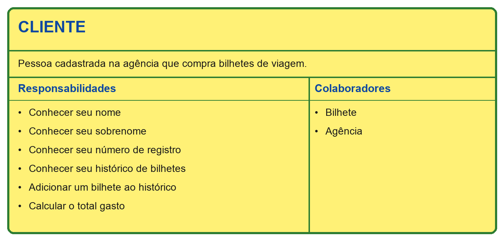
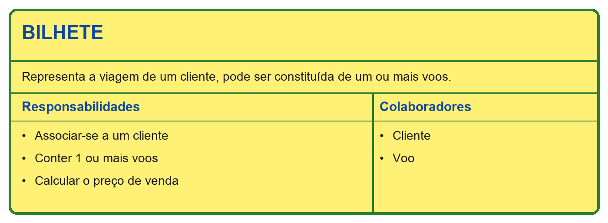
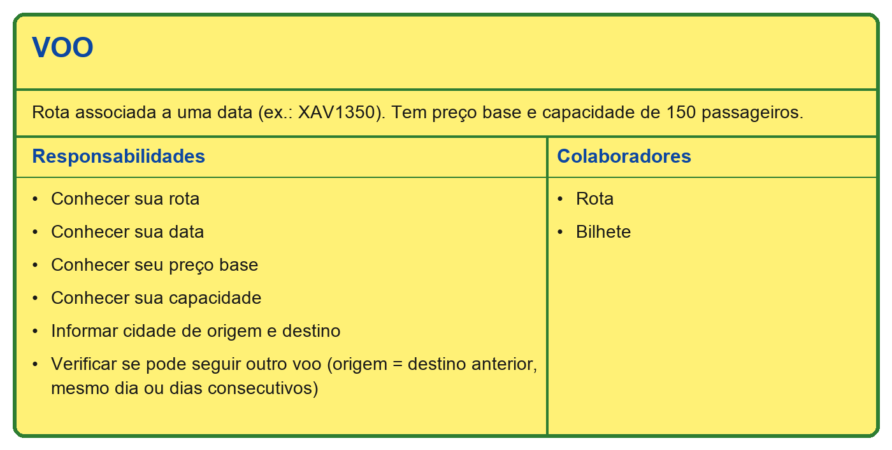
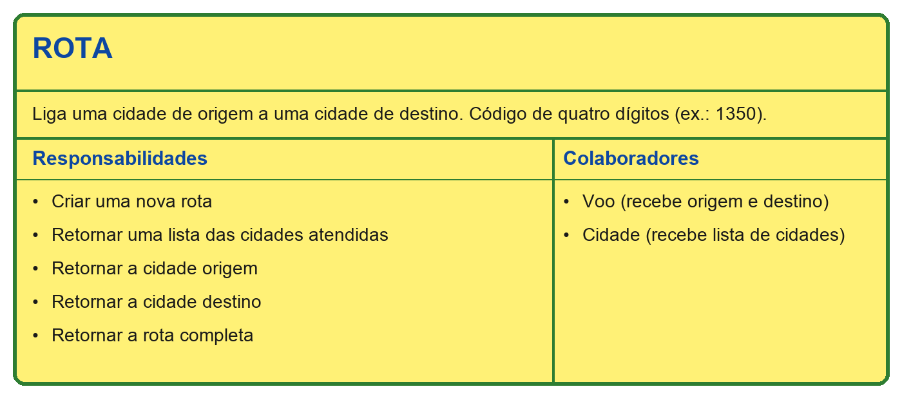
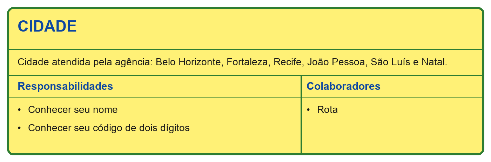
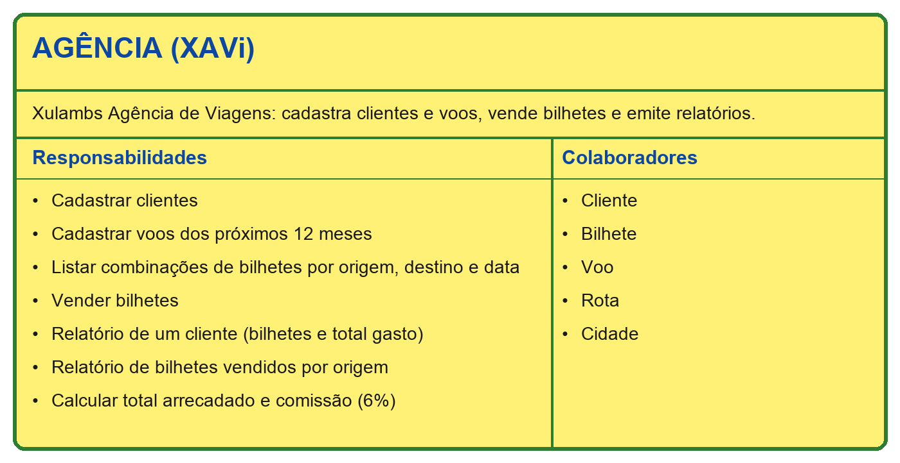
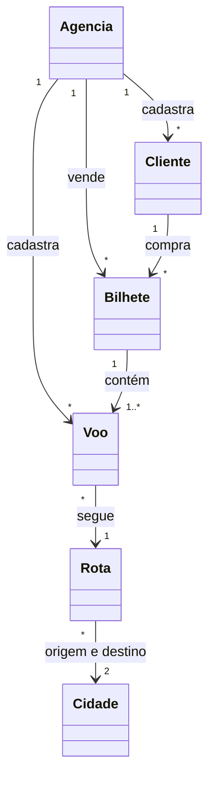

# Sugestão de Integração — XAVi

Cartões CRC das classes do sistema XAVi (Xulambs Agência de Viagens), Programação Modular, PUC Minas.

## Cartões

| Classe | Cartão |
|---|---|
| Cliente | [CRC-Cliente.png](cartoes/CRC-Cliente.png) |
| Bilhete | [CRC-Bilhete.png](cartoes/CRC-Bilhete.png) |
| Voo | [CRC-Voo.png](cartoes/CRC-Voo.png) |
| Rota | [CRC-Rota.png](cartoes/CRC-Rota.png) |
| Cidade | [CRC-Cidade.png](cartoes/CRC-Cidade.png) |
| Agência | [CRC-Agencia.png](cartoes/CRC-Agencia.png) |

## Pré-visualização

## Modelo do sistema

## Regras principais

- Rota: código de quatro dígitos (dois da cidade de origem, dois da de destino).
- Voo: rota associada a uma data, com preço base e capacidade de 150 passageiros.
- Bilhete: voos encadeados (origem do seguinte = destino do anterior), no mesmo dia ou em dias consecutivos.
- Preço de venda: 60% do voo mais caro + 40% do segundo mais caro + 10% de cada voo adicional.
- Comissão da agência: 6% do valor dos bilhetes.
